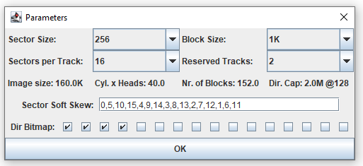

Various files that I have written in Python.

# Python

## Skip_Trackdata

A program that parses *.dsk disk images for the FDD 3000 so that they can be opened seamlessly in the [CP/M DSK Tool](https://forum.vcfed.org/index.php?threads/cp-m-dsk-tool.46217/). The processed image has to be cleared from the header (first 256 bytes), followed by 256 bytes of track data, 4 KB of data have to be fetched, 256 bytes of track data have to be skipped, etc.

After truncating the mentioned data, the image can be loaded into CP/M Disk Tool with these parameters without problems.

## Byte_Inverter

The program came up because the floppy disk format for Indus CP/M is a bit odd - namely, from the end of the reserved tracks, all bytes are treated with an XOR $FF operation. 

Byte inverter accepts three parameters on the command line - the name of the input file, the name of the output file, and the offset from which to invert the bytes.
